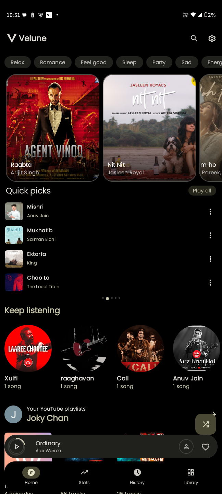
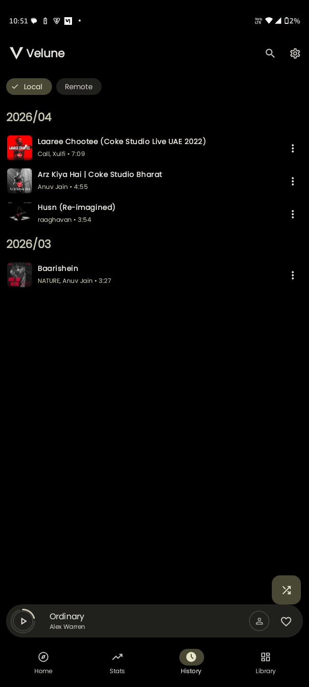
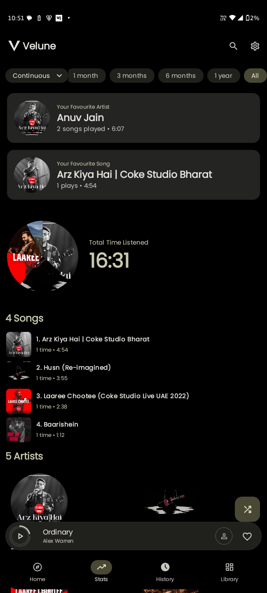
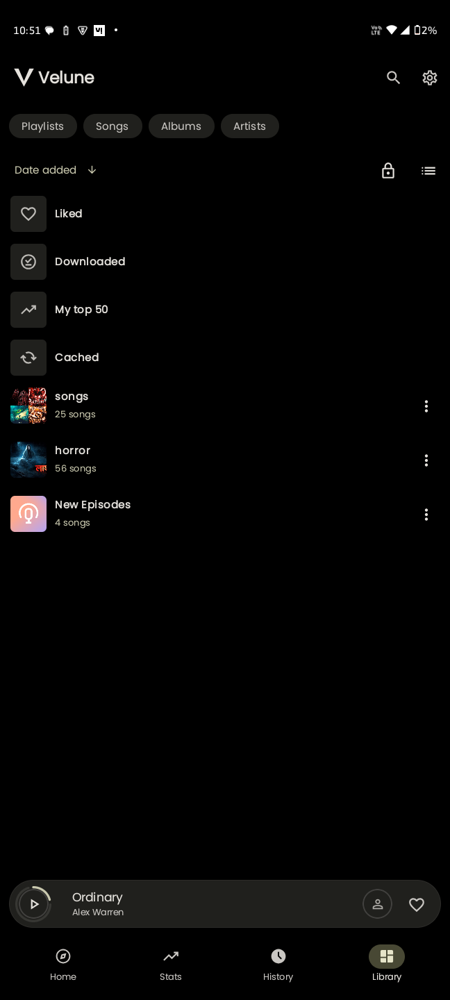
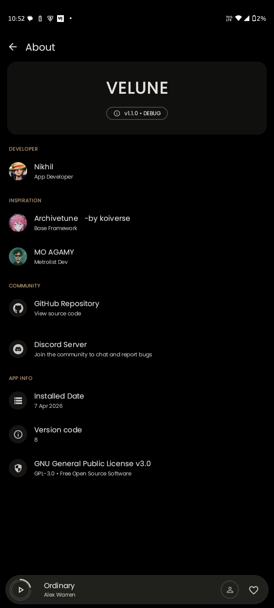

<div align="center">

 

</div>

# 🌌 Musify
<div align="center">

<pre>
██╗   ██╗███████╗██╗     ██╗   ██╗███╗   ██╗███████╗
██║   ██║██╔════╝██║     ██║   ██║████╗  ██║██╔════╝
██║   ██║█████╗  ██║     ██║   ██║██╔██╗ ██║█████╗
╚██╗ ██╔╝██╔══╝  ██║     ██║   ██║██║╚██╗██║██╔══╝
 ╚████╔╝ ███████╗███████╗╚██████╔╝██║ ╚████║███████╗
  ╚═══╝  ╚══════╝╚══════╝ ╚═════╝ ╚═╝  ╚═══╝╚══════╝
</pre>

</div>

### 🎧 The YouTube Music app you always wanted

🚫 No Ads • 💰 No Subscription • ⚡ Full Control  

<div align="center">


<br>


</div>

## 📱 Musify

**Musify** is a modern Android music player built from the supplied Velune source, rebranded with the new Musify identity and your supplied logo.

### Included features
- YouTube Music search and music discovery
- Background audio playback
- Local music library and downloads
- Playlists, queue, history and favorites
- Lyrics and synchronized lyrics support
- Albums, artists, charts and new releases
- Equalizer, crossfade, tempo and pitch controls
- Sleep timer and playback controls
- Discord Rich Presence integration
- Music Together / synchronized listening
- Android home-screen media controls and widgets
- Multiple languages

### App identity
- **App name:** Musify
- **Application ID:** `com.musify.music`
- **Version:** 1.0.0
- **Minimum Android:** Android 8.0 (API 26)
- **Target Android:** API 36
- **Primary architecture for most modern phones:** `arm64`

### Build on GitHub Codespaces
Use the included Gradle wrapper and build the universal release APK with:

```bash
chmod +x gradlew
./gradlew :app:assembleUniversalRelease
```

The APK is produced under `app/build/outputs/apk/universal/release/`.

## 📥 Download Now


<div align="center">

<h2>Stable Release</h2>

<table>
  <thead>
    <tr>
      <th align="center">Obtainium</th>
      <th align="center">IzzyOnDroid</th>
    </tr>
  </thead>
  <tbody>
    <tr>
      <td align="center">
        <a href="https://apps.obtainium.imranr.dev/redirect?r=obtainium://add/https://github.com/nikhilvishwakarma00/Musify">
          
        </a>
      </td>
      <td align="center">
        <a href="https://apt.izzysoft.de/fdroid/index/apk/com.nikhil.yt">
          
        </a>
      </td>
    </tr>
    <tr>
      <th align="center" colspan="2">GitHub</th>
    </tr>
    <tr>
      <td align="center" colspan="2">
        <a href="https://github.com/nikhilvishwakarma00/Musify/releases/latest">
          
        </a>
      </td>
    </tr>
  </tbody>
</table>

</div>


## 🚀 Why Musify?

Musify is not just another music player — it's a **complete reimagination of YouTube Music**.

* ⚡ **Faster** than the official app
* 🎵 Built for audiophiles & power users
* 📦 True offline-first experience
* 🎨 Stunning **Material You** interface

> 💡 This is YouTube Music — *but unlocked*

---

## 🎯 Highlight Feature

### 🎤 Real-Time Synced Lyrics

Experience lyrics like never before:

- Word-by-word sync  
- Smooth animations  
- Translation support  
- Fully immersive playback  

---

## 📸 Preview

<div align="center">






<br/>





</div>


---

## ✨ Features

### 🎵 Core Experience
- Ad-Free Playback  
- Full Library Sync  
- Offline Caching (Encrypted)  
- Background Playback  

### 🔊 Audio Engine
- Gapless Playback  
- Crossfade Engine  
- Silence Skipping  
- Loudness Normalization (EBU R128)  
- Tempo & Pitch Control  
- System EQ Integration  

### 🎨 UI & Discovery
- Material You (Dynamic Colors)  
- Synced Lyrics + Translation  
- Discord Rich Presence  
- Personalized Home Feed  
- Year in Review Stats  
- Custom Animated Loader  

---

## 🧠 Architecture

Built using **modern Android engineering principles**:

- MVVM + Clean Architecture  
- Unidirectional Data Flow (UDF)  
- Modular & scalable codebase  

---

## 🛠 Tech Stack

| Layer | Stack |
|------|------|
| Language | Kotlin |
| UI | Jetpack Compose + Material 3 |
| Audio | Media3 / ExoPlayer |
| DI | Hilt |
| Database | Room (Encrypted) |
| Networking | Ktor + Retrofit |
| Async | Coroutines + Flow |
| Build | Gradle KTS |

---

## 📂 Project Structure

```bash
musify/
├── app/
├── innertube/
├── lrclib/
├── kizzy/
├── canvas/
├── lastfm/
├── kugou/
```

Getting Started \
Requirements\
Android Studio Ladybug+\
JDK 17
Android SDK 34+ \
Run Locally\
Bash
```
git clone https://github.com/nikhilvishwakarma00/Musify.git\
cd Musify\

```
Open in Android Studio → Sync → Run ▶ \
📦 Download
 

🚀 Get Latest Release⁠ 

-------------------------------------------------------------------------

## 💬 Community

Have a feature request, found a bug,
or just want to share your favorite music setups? Join the official Musify community!

* *Discord:* [Join the Musify Server](https://discord.gg/cJNHTdpP6H)
* *GitHub Discussions:* [Open a Discussion](https://github.com/nikhilvishwakarma00/Musify/discussions)


--------------------------------------------------------------------------------------------------------------


🙌 Credits\
Huge respect to these projects:

Archivetune -base framework

Metrolist

InnerTune

Kizzy

SimpMusic

BetterLyrics

⚖️ Legal
Musify is an independent client and is not affiliated with YouTube or Google.\
Please support artists through official platforms ❤️\
Licensed under GPL-3.0
 

💙 Built with passion by Nikhil\
⭐ Star the repo if Musify impressed you\
🚀 Help it reach more people

## 🔗 Star History

<div align="center">
  <a href="https://star-history.com/nikhilvishwakarma00/musify&Date">
    <picture>
      <source media="(prefers-color-scheme: dark)" srcset="https://api.star-history.com/svg?repos=nikhilvishwakarma00/musify&type=Date&theme=dark" />
      <source media="(prefers-color-scheme: light)" srcset="https://api.star-history.com/svg?repos=nikhilvishwakarma00/musify&type=Date" />
      
    </picture>
  </a>

  <br/>
  <br/><br/>
</div>
 
